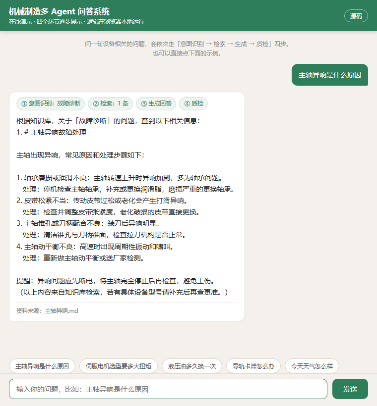

# 机械制造多 Agent 问答系统

**在线演示：<https://liu-97-coder.github.io/mechanical-multiagent-qa/>**（浏览器直接打开，不用装任何东西）



一个把设备资料做成 "能问答" 的小系统。你在命令行问一句，它从知识库里找出相关资料，
组织成回答，最后再自查一遍。适合用来演示 "多 Agent + RAG" 怎么落地。

## 在线演示

`docs/` 目录下是同一套算法的浏览器版：字符 2-gram + IDF 检索、四环节编排、质检逻辑与 `rag.py` /
`agents.py` 一一对应，只是把 Python 换成了 JS，方便任何人点开就能看到效果（无需运行环境、无需联网）。

## 怎么跑（本地）

不需要装第三方库，有 Python 3 即可：

**网页版（推荐，更直观）：**
```bash
python webapp.py
```
启动后在本机浏览器打开 `http://localhost:8001`（本机地址，需先运行程序），会一步步展示每个 Agent 干了什么。

**命令行版：**
```bash
python main.py
```

然后直接问，例如：

```text
你问：主轴异响是什么原因
你问：伺服电机选型要多大扭矩
你问：液压油多久换一次
```

输入 `exit` 退出。

## 它内部怎么工作（四个小模块分工）

每次提问会依次走四个 "Agent"，每个只干一件事，运行时会一步步打印给你看：

| Agent | 干什么             | 对应到技术概念   |
| ----- | --------------- | --------- |
| 意图识别  | 判断你问的是故障、选型还是保养 | Intent    |
| 检索    | 去知识库找相关资料       | Retriever |
| 生成    | 把资料组织成回答        | Generator |
| 质检    | 看回答有没有覆盖你问的关键词  | Verifier  |

## 知识库在哪里

`knowledge/` 目录下是示例资料：主轴异响、液压压力不足、电机过载、维护保养、伺服选型、导轨卡滞。

往里加 `.md` 或 `.txt` 文件，重启程序就能被检索到。正式场景换成真实手册、维修记录即可。

## 怎么接真实大模型（可选）

默认不接，用模板也能跑。想让它说话更自然，编辑 `config.py`：

```python
LLM_ENABLED = True
LLM_API_KEY = "你的key"
LLM_BASE_URL = "https://dashscope.aliyuncs.com/compatible-mode/v1"  # 通义示例
LLM_MODEL = "qwen-plus"
```

支持任何 OpenAI 兼容接口（通义、豆包、OpenAI 等），接口在 `llm.py`。

## 目录结构

```text
mechanical-multiagent-qa/
├─ main.py        入口，命令行问答
├─ agents.py      四个 Agent
├─ rag.py         知识库读取 + 检索（换向量库只需改这里）
├─ llm.py         可选的大模型客户端
├─ config.py      配置（是否接大模型、key）
├─ knowledge/     示例知识库（可自由增删）
└─ docs/          在线演示页（GitHub Pages）
```
